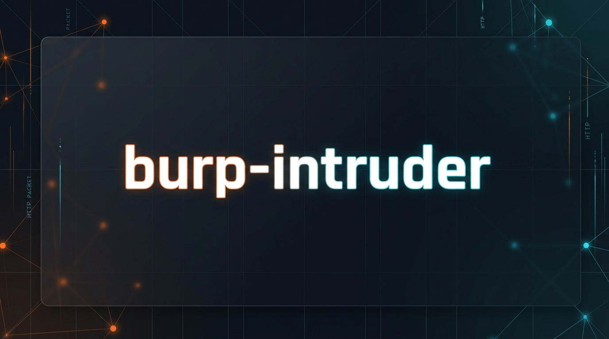

<p align="center">
  
</p>

# burp-intruder

**burp-intruder** is a custom, high-speed Burp Suite extension designed to automate HTTP fuzzing, payload injection, and response analysis with a streamlined multi-tab workflow.

---

## Features

- **Context Menu Integration:** Right-click any request in Burp Suite and select **Send to burp-intruder** to open a dedicated scan tab.
- **Multi-Tab Workspace:** Run and organize multiple independent scans simultaneously; double-click any tab to rename it.
- **Custom Request Engine:** Configure payload positions, wordlists, and concurrent request execution.
- **Brotli Decompression Support:** Built-in `org.brotli.dec` support for inspecting compressed HTTP responses.
- **Default Grep Terms:** Pre-configured with `default_grep_terms.txt` to quickly spot interesting strings, errors, and sensitive fields in responses.

---

## Installation

### Option 1: Pre-compiled JAR (Recommended)
1. Download the latest `burp-intruder.jar` from the [Releases](../../releases) page.
2. Open **Burp Suite** -> **Extensions** -> **Installed** -> **Add**.
3. Select **Extension type: Java** and choose the downloaded `burp-intruder.jar`.

### Option 2: Build from Source
Using **Gradle**:
```bash
./gradlew jar
```
Or using the included Windows batch script (`build.bat` — adjust `JAVA_BIN` if needed):
```cmd
build.bat
```
The compiled JAR will be generated as `burp-intruder.jar`.

---

## Usage

1. Intercept or select any HTTP request in Burp Suite (Proxy, Repeater, Target, etc.).
2. Right-click and choose **Send to burp-intruder**.
3. Configure your target, payload markers, and grep terms in the new tab.
4. Start the scan and inspect the results in real time.

---

## Disclaimer

> **For Authorized Security Testing & Educational Purposes Only.**
>
> burp-intruder is intended strictly for authorized penetration testing, bug bounty hunting within defined program scopes, and educational research. You are solely responsible for ensuring you have explicit, written permission before testing any target system. Unauthorized access or automated scanning against systems you do not own or have permission to test is illegal. The author assumes no liability for any misuse or damage caused by this tool.

---

## License

This project is licensed under the **MIT License** — see the [LICENSE](LICENSE) file for details.
